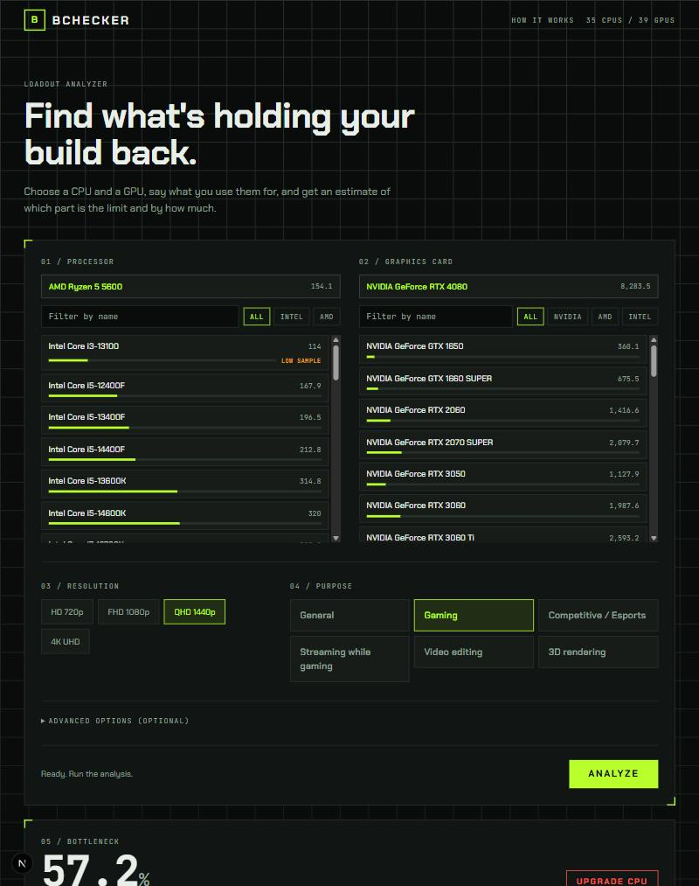

# BChecker

A CPU and GPU bottleneck estimator styled as a stamped laboratory test report. Pick a processor, a graphics card, a resolution and what you use the PC for, and BChecker estimates which part is holding the other back and by how much.

**Live site: https://bchecker-next.vercel.app**



This is a rebuild of an earlier Laravel + PHP + MySQL version. The hand-entered 48-row result table is gone: results are now computed from published benchmark scores for 70 CPUs and 75 GPUs (from 2011-era CPUs and 2014 GPUs up to the newest), with no database.

## How it works

1. Every part has a **score**: the median result from [Blender Open Data](https://opendata.blender.org) (Cycles path-tracing samples per minute).
2. Your purpose and resolution set the **share of the work** that lands on the GPU (the CPU gets the rest). Optional target refresh rate shifts work toward the CPU.
3. Each part's score is divided by its share of the work. The lower of the two limits the build, and `bottleneck = (1 - weaker / stronger) x 100`. At 10% or less the build counts as balanced.

Calibration: scores are scaled so that an **i5-13400F + RTX 3070 at gaming / 1080p** comes out balanced (about 0%).

Options: 4 resolutions (HD, FHD, QHD, 4K), 6 purposes (general, gaming, competitive/esports, streaming while gaming, video editing, 3D rendering), optional refresh rate (60/120/144/240 Hz) and optional RAM size (8/16/32/64 GB, which only produces advice and never changes the percentage).

## Limits (please read)

- The score is **rendering speed, not game frame rates**. Treat the output as an estimate.
- Workload shares, the refresh-rate effect and the RAM rules are my own heuristics, labelled as such on the page. Only the CPU and GPU scores are real data.
- NVIDIA GPUs use OptiX, AMD uses HIP and Intel uses oneAPI (each vendor's Blender default). OptiX uses ray-tracing hardware, so cross-vendor comparisons are approximate.
- All scores come from one Blender version (4.5.0 LTS) so old and new parts are comparable. Intel Core i3-13100 has only 2 submissions and is flagged "Low sample". AMD GPUs older than the RX 5000 series have no usable Blender data and are not listed.
- Desktop parts only.

Data provenance and the licensing check (PassMark was considered and rejected because its terms don't allow republishing scores) are in [docs/data-sources.md](docs/data-sources.md).

## Run it

Requires Node 22.12+ (developed on Node 24). Released under the MIT license.

```bash
npm install
npm run dev      # http://localhost:3000
npm test         # Vitest
npm run lint
npm run build
```

No environment variables and no database. It deploys to Vercel as-is.

## Project structure

```
src/
  app/page.tsx                  page: loadout, how it works, about the data
  app/api/bottleneck/route.ts   POST /api/bottleneck
  components/                   HUD UI (PartPicker, Segmented, Loadout, Gauge, Result, ...)
  data/parts.ts                 70 CPUs + 75 GPUs with scores, sources, dates
  data/options.ts               resolutions, purposes, refresh rates, RAM sizes, workload shares
  lib/model.ts                  the estimate (pure)
  lib/calibration.ts            reference scores
  lib/lookup.ts                 input validation + estimate
  lib/advisories.ts             RAM advice rules
docs/                           design spec, implementation plan, data sources
```

### API

`POST /api/bottleneck` with JSON `{ cpuId, gpuId, resolutionId, purposeId, refreshHz?, ramGb? }`.
Returns 200 with `{ cpuName, gpuName, cpuScore, gpuScore, bottleneck, limiting, note, gpuShare, cpuPower, gpuPower, advisories }`, 400 `{ error: "invalid_input" }`, or 404 `{ error: "not_found" }`.

### Adding a part

Add a row to `CPUS` or `GPUS` in `src/data/parts.ts` with the score read from its source page (never from memory), the submission count, the source URL and the date you read it. `npm test` checks every row for completeness and unique ids.

## Credits

Benchmark data: [Blender Open Data](https://opendata.blender.org). Built by Zxaviers. Fonts: Chakra Petch and JetBrains Mono.
